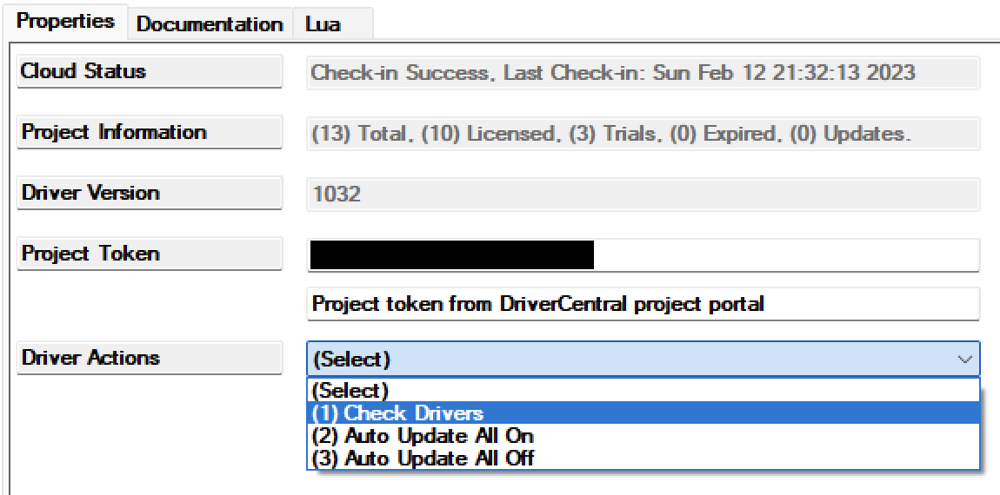

<!-- Copyright 2026 Finite Labs, LLC. All rights reserved. -->

______________________________________________________________________

# Overview

> DISCLAIMER: This software is neither affiliated with nor endorsed by either
> Control4 or TP-Link.

The TP-Link Light driver adds a Control4 light backed by a TP-Link device. It
works in one of two modes:

- **Direct mode**: the driver connects to a TP-Link light on your network: a
  Tapo L900, L920 or L930 light strip, a Tapo bulb, or a Kasa KL- or LB-series
  bulb or light strip, on original or newer firmware. The driver works out how
  the light connects. Brightness, color and color temperature are offered when
  the light has them.
- **Proxy mode**: the driver's TP-Link Outlet connection is bound to an output
  of the TP-Link Outlet driver. The light is then an on/off switch light backed
  by that outlet, useful for lamps and fixtures plugged into a smart outlet.

A bound outlet takes priority: while the connection is bound, the network
properties are hidden and ignored.

In direct mode the driver follows the light. When it stops answering, the driver
detects its protocol again, so it keeps working when a firmware update, a
rollback or a reset changes how the light connects. When it gets a new address
on the controller's network, the driver finds it by its MAC address and updates
`IP Address` (OS 4.0 and later).

A Tapo light takes no fade time from a command: its only fades are the short
ones set in the Tapo app. The `Fades` property chooses who makes a fade on such
a light, the driver or the light. A Kasa bulb takes the fade time with each
command and fades by itself.

# Index

- [System Requirements](#system-requirements)
- [Features](#features)
- [Compatibility](#compatibility)
- [Installer Setup](#installer-setup)
  <!-- #ifdef DRIVERCENTRAL -->
  - [DriverCentral Cloud Setup](#drivercentral-cloud-setup)
  <!-- #endif -->
  - [Driver Installation](#driver-installation)
  - [Driver Properties](#driver-properties)
    - [Cloud Settings](#cloud-settings)
    - [Driver Settings](#driver-settings)
    - [TP-Link Settings](#tp-link-settings)
  - [Driver Actions](#driver-actions)
  - [Connections](#connections)
- [Programming](#programming)
- [Troubleshooting](#troubleshooting)
  <!-- #ifdef DRIVERCENTRAL -->
- [Developer Information](#developer-information)
  <!-- #endif -->
- [Support](#support)
- [Changelog](#changelog)

# System Requirements

- Control4 OS 3.3+
- Direct mode: a TP-Link light on a network reachable from the controller. Tapo
  lights and Kasa lights updated since late 2024 also need the credentials of
  the TP-Link account they are set up with; Kasa KL/LB-series bulbs on original
  firmware need none. Lights on newer firmware work with **Third-Party
  Compatibility** on or off in the Tapo or Kasa app. With it off they need
  Control4 OS 3.4.1 or later
- Proxy mode: a configured TP-Link Outlet driver instance

# Features

All standard light features are available where the light supports them:

- On and off, and brightness with target ramps and stop
- Color and color temperature, with ramps
- Click and hold button rates
- Advanced Lighting Scenes
- Brightness and color presets, and Dim-To-Warm as a Color On Mode

# Compatibility

**Verified hardware:**

| Device | Type        | Features                      | Mode   |
| ------ | ----------- | ----------------------------- | ------ |
| L930-5 | Light strip | Brightness, color, color temp | Direct |
| KL130  | Bulb        | Brightness, color, color temp | Direct |
| HS110  | Smart plug  | On/off via outlet binding     | Proxy  |
| KP115  | Smart plug  | On/off via outlet binding     | Proxy  |

Other Kasa KL- and LB-series bulbs (KL110, KL120, KL125, KL135) and Kasa light
strips (KL400, KL420, KL430) are expected to work in direct mode on original or
newer firmware. Starting any light command from Control4 takes over from a
lighting effect running on a strip; effects themselves are not controllable from
Control4.

<!-- #ifdef DRIVERCENTRAL -->

If you have a model that works and is not listed, or one that does not work,
please contact us at
[driver-support@finitelabs.com](mailto:driver-support@finitelabs.com).

<!-- #else -->

If you have a model that works and is not listed, or one that does not work,
please
[open an issue](https://github.com/finitelabs/control4-tplink/issues/new).

<!-- #endif -->

# Installer Setup

<!-- #ifdef DRIVERCENTRAL -->

## DriverCentral Cloud Setup

> If you already have the
> [DriverCentral Cloud driver](https://drivercentral.io/platforms/control4-drivers/utility/drivercentral-cloud-driver/)
> installed in your project you can continue to
> [Driver Installation](#driver-installation).

This driver relies on the DriverCentral Cloud driver to manage licensing and
automatic updates. If you are new to using DriverCentral you can refer to their
[Cloud Driver](https://help.drivercentral.io/407519-Cloud-Driver) documentation
for setting it up.

<!-- #endif -->

## Driver Installation

<!-- #ifdef DRIVERCENTRAL -->

1. Download the latest `control4-tplink.zip` from
   [DriverCentral](https://drivercentral.io/platforms/control4-drivers/lighting/tp-link-kasa-and-tapo).

1. Extract and
   [install](https://www.control4.com/help/c4/software/cpro/dealer-composer-help/content/composerpro_userguide/adding_drivers_manually.htm)
   the `tplink_light.c4z` driver.

1. Use the "Search" tab to find the "TP-Link Light" driver and add it to the
   room the light lives in.

1. Select the newly added driver in the "System Design" tab. You will notice
   that the `Cloud Status` reflects the license state. If you have purchased a
   license it will show `License Activated`, otherwise `Trial Running` and
   remaining trial duration.

1. You can refresh license status by selecting the "DriverCentral Cloud" driver
   in the "System Design" tab and performing the "Check Drivers" action.
    

1. For direct mode, set the [IP Address](#ip-address) property, plus the TP-Link
   credentials for Tapo lights and updated Kasa lights. For proxy mode, bind the
   driver's TP-Link Outlet connection to an output of a TP-Link Outlet driver
   instead.

1. `Driver Status` shows the connection: `Connected (SMART)` for a Tapo light,
   `Connected (KLAP)` for a Kasa light on newer firmware, `Connected (Legacy)`
   for a Kasa light on original firmware, `Connected (TPAP)` for a light with
   Third-Party Compatibility off, or `Connected (Outlet)` in proxy mode. If the
   driver fails to connect, set `Log Mode` to `Print`, run the `Reconnect`
   action, and check the Lua output window.

<!-- #else -->

1. Download the latest `control4-tplink.zip` from
   [GitHub](https://github.com/finitelabs/control4-tplink/releases/latest).

1. Extract and
   [install](https://www.control4.com/help/c4/software/cpro/dealer-composer-help/content/composerpro_userguide/adding_drivers_manually.htm)
   the `tplink_light.c4z` driver.

1. Use the "Search" tab to find the "TP-Link Light" driver and add it to the
   room the light lives in.

1. For direct mode, set the [IP Address](#ip-address) property, plus the TP-Link
   credentials for Tapo lights and updated Kasa lights. For proxy mode, bind the
   driver's TP-Link Outlet connection to an output of a TP-Link Outlet driver
   instead.

1. `Driver Status` shows the connection: `Connected (SMART)` for a Tapo light,
   `Connected (KLAP)` for a Kasa light on newer firmware, `Connected (Legacy)`
   for a Kasa light on original firmware, `Connected (TPAP)` for a light with
   Third-Party Compatibility off, or `Connected (Outlet)` in proxy mode. If the
   driver fails to connect, set `Log Mode` to `Print`, run the `Reconnect`
   action, and check the Lua output window.

<!-- #endif -->

## Driver Properties

### Cloud Settings

<!-- #ifdef DRIVERCENTRAL -->

#### Cloud Status (read-only)

Displays the DriverCentral cloud license status.

<!-- #endif -->

#### Automatic Updates \[ Off | **_On_** \]

<!-- #ifdef DRIVERCENTRAL -->

Turns automatic driver updates from DriverCentral on or off. Changing it on any
TP-Link Outlet or TP-Link Light driver changes it on all of them.

<!-- #else -->

Turns automatic driver updates from GitHub releases on or off. Changing it on
any TP-Link Outlet or TP-Link Light driver changes it on all of them.

#### Update Channel \[ **_Production_** | Prerelease \]

Selects whether automatic updates take only production releases or prereleases
too. Changing it on any TP-Link Outlet or TP-Link Light driver changes it on all
of them.

<!-- #endif -->

### Driver Settings

#### Driver Status (read-only)

Displays the current status of the driver.

<!-- #ifdef DRIVERCENTRAL -->

Without an active DriverCentral license, Driver Status reads
`No active license`. See [Troubleshooting](#troubleshooting).

<!-- #endif -->

#### Driver Version (read-only)

Displays the current version of the driver.

<!-- #ifdef DRIVERCENTRAL -->

#### Log Level \[ 0 - Fatal | 1 - Error | 2 - Warning | **_3 - Info_** | 4 - Debug \]

Sets the logging level. Default is `3 - Info`. While a Support Code has
Composer's Lua tab open, it also offers `5 - Trace` and `6 - Ultra`.

<!-- #else -->

#### Log Level \[ 0 - Fatal | 1 - Error | 2 - Warning | **_3 - Info_** | 4 - Debug | 5 - Trace | 6 - Ultra \]

Sets the logging level. Default is `3 - Info`.

<!-- #endif -->

#### Log Mode \[ **_Off_** | Print | Log | Print and Log \]

Sets the logging mode. Default is `Off`. It goes back to `Off` after 3 hours.

<!-- #ifdef DRIVERCENTRAL -->

#### Support Code

Leave it blank unless Finite Labs support gives you a code: for an hour, it
opens Composer's Lua tab to this driver and adds `5 - Trace` and `6 - Ultra` to
Log Level.

#### Cloud Monitoring \[ Disabled | **_Enabled_** \]

When Enabled, the driver sends Finite Labs a short report once an hour, and a
report of each error it hits, at most 10 a minute. We use them to find and fix
problems in the driver. Set it to Disabled to send nothing.

A report holds the controller's MAC address and OS version, the driver's name,
version, device ID and DriverCentral license status, how much memory the driver
uses, and the sizes of its largest internal tables. An error report also holds
the error message and where in the driver it happened. Before a message is sent,
anything in it that looks like a password, token, key, network address or email
address is removed.

<!-- #endif -->

### TP-Link Settings

#### IP Address

Sets the IP address of the light for direct mode. Leave blank when bound to an
outlet. Use a DHCP reservation so it does not change. If the light does get a
new address on the controller's network, the driver finds it by its MAC address
and updates this property (OS 4.0 and later). Entering an address by hand points
the driver at whichever light answers there.

#### MAC Address (read-only)

Displays the MAC address of the light, learned when the driver first connects to
it.

#### Protocol \[ **_Auto_** | KLAP | TPAP | Legacy \]

Selects the local protocol for direct mode. `KLAP` is the encrypted protocol of
Tapo lights, and of Kasa KL/LB-series bulbs and light strips on firmware updated
since late 2024. `TPAP` is the protocol the same lights use when Third-Party
Compatibility is off in the Tapo or Kasa app. `Legacy` is the protocol of Kasa
KL/LB-series bulbs and light strips on original firmware.

`Auto` (default) tries KLAP first when credentials are set, then TPAP when the
light refuses KLAP, and falls back to the legacy protocol; without credentials
it connects over the legacy protocol directly. Pin it to one only if you need to
skip detection.

#### TP-Link Username / TP-Link Password

Sets the credentials of the TP-Link (Kasa or Tapo) account the light is set up
with. The email is case sensitive. They are used only to connect to the light on
your network in direct mode; the driver never contacts TP-Link's cloud. Required
for Tapo lights and Kasa lights updated since late 2024; may be left blank for
Kasa KL- or LB-series lights on original firmware.

#### Poll Rate (Seconds) \[ 2 - 300, default: **_5_** \]

Sets how often the driver reads the light's state in direct mode. Default is
`5`.

#### Fades \[ **_Driver_** | Light \]

Selects who makes a fade on a light that takes no fade time from a command. A
Tapo light is one: whatever ramp rate it is sent, it changes over its own short
fades, the ones set in the Tapo app. The property is shown only while such a
light is connected. A Kasa bulb fades over the time each command carries, and a
light bound to an outlet only switches, so neither has the choice.

- `Driver` (default): the driver makes the fade. It sends the light a new level
  or color as fast as the light answers, a few times a second, until the fade
  ends. Ramp rates, stops, held buttons and scene fades work as they do on other
  lights. What it costs:
  - A slow fade moves level by level; a quick one is a few visible steps (an on
    over three quarters of a second is three or four), each taken over the
    light's own fade between states where that is on in the Tapo app, and at
    once where it is off.
  - A level or an off set from the Tapo app or another controller during a fade
    is usually overridden by the fade's next step.
  - A fade ends where it is if the light stops answering part way, or if the
    driver reconnects to it: Control4 shows where the light is when it next
    answers.
  - After a fade to off the light itself remembers the last step it was sent on
    the way down, so it comes on dim when it is turned on from the Tapo app.
    Control4 always turns it on at a level of its own.
- `Light`: the light fades by itself. When `Light` is chosen, and each time the
  light connects, the driver switches on the light's own fades that are off (to
  on, to off and between two states), each at the length already set in the Tapo
  app. A change is then one command, and Control4 shows the light's own fade:
  the length set for an on or an off, and about a second between two states. An
  older Tapo light has one switch for all its fades and gives no length for
  them, and some report no fade between two states: the driver switches on what
  the light has, and Control4 shows a change it has no length for at once. What
  it costs:
  - Ramp rates are the light's. A rate set in Composer, on a keypad or in a
    scene does nothing, though a scene still waits out a step's ramp time before
    its next step.
  - A stop does nothing, and a held button takes the light all the way up or
    down. A click first starts the light toward full or off, then sets the
    click's level. Where the light has no fade for the change, the click goes
    straight to its level.
  - The fades the driver switched on stay on when `Driver` is chosen again.

## Driver Actions

### Reconnect

Drops the connection to the light and connects again, working out its protocol
again.

<!-- #ifndef DRIVERCENTRAL -->

### Update Drivers

Updates every TP-Link driver in the project to the latest release on GitHub,
even when it is already current.

<!-- #endif -->

<!-- #ifdef DRIVERCENTRAL -->

### Diagnostics Snapshot

Prints a report in the Lua output, and sends it to Finite Labs only while Cloud
Monitoring is Enabled.

<!-- #endif -->

## Connections

### Light (provider)

The Control4 light that rooms, keypads and scenes use.

### TP-Link Outlet (consumer)

Bind to an `Output N Light` connection of a TP-Link Outlet driver for proxy
mode.

### On / Off / Toggle Button Link (provider)

Bind a keypad button to switch the light; its LED follows the light.

# Programming

The driver exposes the standard Control4 light programming surface: light level
events and commands, advanced scene support, brightness and color presets, and
click/hold rates. In proxy mode the light is on/off only and brightness
collapses to 0/100. A level or color the light still has when the driver starts,
is updated or reconnects runs no Brightness Changed, Color Changed, Light On,
Light Off or Level Change programming. After a controller restart Control4 still
reports the color variables of a light with color or color temperature as
changed, as it learns the light's capabilities again.

With **Color On Mode** set to Dim-To-Warm, a color set while the light is on,
from a Navigator, programming, a color preset or an Advanced Lighting Scene,
stays when the light is dimmed or brightened. The light follows Dim-To-Warm
again the next time it turns on, and from its first level change after a
controller restart or a driver update.

# Troubleshooting

<!-- #ifdef DRIVERCENTRAL -->

**`Driver Status` reads `No active license`**: The driver has had no active
DriverCentral license for five minutes, so it has stopped controlling the light
and shows it offline at the level it had. Check its `Cloud Status`, and refresh
the license with the **DriverCentral Cloud** driver's **Check Drivers** action.
The driver checks every 10 seconds and starts again once a license is active.

<!-- #endif -->

**`Driver Status` shows `Bind to an outlet or set the IP Address property`**:
the driver has neither an outlet binding nor a direct-mode configuration.

**Direct mode never connects**: check the IP address and that no firewall or
network rule stops the controller reaching the light. For Tapo lights and Kasa
lights updated since late 2024, check that the credentials match the account the
light is set up with in the Tapo or Kasa app. A wrong account shows in the Lua
output with `Log Mode` set to `Print`.

**`Disconnected: ... the TP-Link account password was refused ...`**: The light
has Third-Party Compatibility off and refused the password. Enter the password
of the TP-Link account the light is set up with in the Tapo or Kasa app. The
driver does not try again until `TP-Link Username` or `TP-Link Password`
changes, because every refused password counts toward the device locking itself.

**`Disconnected: ... the device is locked for ... minutes after failed logins`**:
Too many wrong passwords were tried, by this driver or another app. The driver
waits out the time shown, then tries once more.

**`Disconnected: ... TPAP needs Control4 OS 3.4.1 or later ...`**: The device
has Third-Party Compatibility off, and this controller's OS is too old for the
login that needs. Update the controller, or turn **Third-Party Compatibility**
on in the Tapo app (under **Me**, then **Tapo Lab**) or the Kasa app (under
**Settings**).

**`Disconnected: ... asks for a login this driver does not support yet ...`**:
Turn **Third-Party Compatibility** on in the Tapo or Kasa app.

**`Disconnected: ... device refused the handshake (HTTP 403) ...`**: The device
is refusing connections from other apps, and did not offer the login it uses
with Third-Party Compatibility off. Work through these in order:

1. Make sure **Third-Party Compatibility** is on in the Tapo app (under **Me**,
   then **Tapo Lab**) or the Kasa app (under **Settings**). Firmware updates are
   known to turn it off.
1. If it is already on, turn it off and back on. A device added after the
   setting was turned on, or one that was just updated, may keep refusing
   connections until the setting is toggled, even though the app shows it on.
1. Run the [`Reconnect`](#reconnect) action. The driver also retries on every
   poll, so the status clears on its own once the device accepts the connection.
1. If it still fails, turn the light's power off for a few seconds, then run
   [`Reconnect`](#reconnect) again.

**`Disconnected: a different device is at ...; looking for this one`**: another
TP-Link device now answers at the light's address, usually after DHCP gave the
address to it. The driver controls nothing there and looks for its own light on
the network. If you replaced the light, enter its address in
[`IP Address`](#ip-address) to use the new one.

**A Kasa light strip shows the wrong brightness while an app effect runs**: the
strip reports the effect's brightness while a lighting effect is active; any
light command from Control4 stops the effect and takes over.

**Device is a Kasa plug or strip, not a light**: use the TP-Link Outlet driver
for the device and bind this driver to one of its outputs instead of using
direct mode.

<!-- #ifdef DRIVERCENTRAL -->

# Developer Information

Copyright © 2026 Finite Labs LLC

All information contained herein is, and remains the property of Finite Labs LLC
and its suppliers, if any. The intellectual and technical concepts contained
herein are proprietary to Finite Labs LLC and its suppliers and may be covered
by U.S. and Foreign Patents, patents in process, and are protected by trade
secret or copyright law. Dissemination of this information or reproduction of
this material is strictly forbidden unless prior written permission is obtained
from Finite Labs LLC. For the latest information, please visit
https://drivercentral.io/platforms/control4-drivers/lighting/tp-link-kasa-and-tapo

<!-- #endif -->

# Support

<!-- #ifdef DRIVERCENTRAL -->

If you have any questions or issues integrating this driver with Control4 or
your TP-Link device, you can contact us at
[driver-support@finitelabs.com](mailto:driver-support@finitelabs.com) or
call/text us at [+1 (949) 371-5805](tel:+19493715805).

<!-- #else -->

If you have any questions or issues integrating this driver with Control4, you
can file an issue on GitHub:

https://github.com/finitelabs/control4-tplink/issues/new

<!-- #endif -->

<!-- #embed-changelog -->
