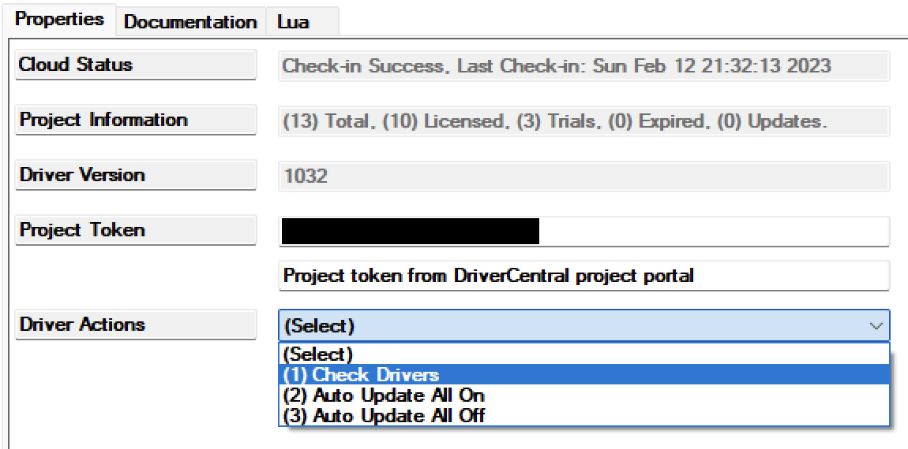

<!-- Copyright 2026 Finite Labs, LLC. All rights reserved. -->

______________________________________________________________________

# Overview

<!-- #ifndef DRIVERCENTRAL -->

> DISCLAIMER: This software is neither affiliated with nor endorsed by either
> Control4 or TP-Link.

<!-- #endif -->

The TP-Link Outlet driver provides local, cloud-free control of TP-Link Kasa and
Tapo smart plugs and power strips directly from Control4.

It works with Kasa devices on original firmware, with Kasa devices TP-Link has
updated since late 2024, and with Tapo plugs and newer Kasa plugs. The driver
works out how the device connects, so the same driver keeps working when TP-Link
updates the device's firmware.

Each output is exposed as a standard Control4 **relay binding**, along with
per-output events, variables, and real-time power (wattage) readings for
programming.

# Index

- [System Requirements](#system-requirements)
- [Features](#features)
- [Compatibility](#compatibility)
- [Installer Setup](#installer-setup)
  <!-- #ifdef DRIVERCENTRAL -->
  - [DriverCentral Cloud Setup](#drivercentral-cloud-setup)
  <!-- #endif -->
  - [Driver Installation](#driver-installation)
  - [Driver Setup](#driver-setup)
    - [Driver Properties](#driver-properties)
      - [Cloud Settings](#cloud-settings)
      - [Driver Settings](#driver-settings)
      - [TP-Link Settings](#tp-link-settings)
      - [Device Information](#device-information)
      - [Outputs](#outputs)
    - [Driver Actions](#driver-actions)
  - [Connections](#connections)
  - [Programming](#programming)
- [Troubleshooting](#troubleshooting)
  <!-- #ifdef DRIVERCENTRAL -->
- [Developer Information](#developer-information)
  <!-- #endif -->
- [Support](#support)
- [Changelog](#changelog)

# System Requirements

- Control4 OS 3.3+
- A TP-Link Kasa or Tapo smart plug or power strip on a network the controller
  can reach
- For Tapo devices and for Kasa devices updated since late 2024, the credentials
  of the TP-Link (Kasa or Tapo) account the device is set up with. Kasa devices
  on original firmware need none.
- Devices on newer firmware work with **Third-Party Compatibility** on or off in
  the Tapo or Kasa app. With it off they need Control4 OS 3.4.1 or later

# Features

- **Local control** of each outlet with no TP-Link cloud dependency after setup
- **Newer firmware**: works with the encrypted protocol TP-Link firmware has
  used since late 2024
- **Tapo and newer Kasa plugs and power strips**, found automatically, with each
  outlet as its own output
- **Original Kasa firmware**: works with no credentials, and keeps working after
  TP-Link updates the device (add your account credentials)
- Standard Control4 **relay bindings** for every output (bind relay-controlled
  devices, use in scenes, dashboards, etc.)
- **Events**: `Output N Turned On` / `Output N Turned Off`, `Connected`,
  `Disconnected`
- **Variables** per output (`Output N Name`, `Output N State`, `Output N Power`,
  `Output N In Use`, and `Voltage`) for use in programming
- **Real-time energy monitoring** per outlet with configurable poll rate
- **Programming commands**: Turn Output On / Turn Output Off / Toggle Output
- **Keypad buttons**: On, Off and Toggle button links for each output, with LEDs
  that follow it
- **In Use / Idle events** for each output, from its power, two levels and a
  hold time you set, on devices with energy monitoring
- Reconnects automatically when the device restarts or drops the connection
- **Follows the device**: when it stops answering, the driver detects its
  protocol again, so it keeps working when a firmware update, a rollback or a
  reset changes how the device connects. When it gets a new address on the
  controller's network, the driver finds it by its MAC address and updates
  `IP Address` (OS 4.0 and later)

# Compatibility

**Verified hardware:**

| Device | Type         | Outputs | Energy Metering  | Shows As             |
| ------ | ------------ | ------- | ---------------- | -------------------- |
| HS300  | Power strip  | 6       | Yes (per outlet) | `Connected (KLAP)`   |
| EP25   | Smart plug   | 1       | Yes              | `Connected (SMART)`  |
| KP115  | Smart plug   | 1       | Yes              | `Connected (Legacy)` |
| HS110  | Smart plug   | 1       | Yes              | `Connected (Legacy)` |
| EP40A  | Outdoor plug | 2       | No               | `Connected (Legacy)` |

Other Kasa and Tapo plugs and power strips are expected to work:

- Kasa plugs and power strips, on original or newer firmware
- Newer Kasa plugs and Tapo plugs, which need the TP-Link account credentials
- Tapo power strips and newer Kasa multi-outlet plugs, with each outlet as its
  own output

Single-outlet devices appear as output 1.

<!-- #ifdef DRIVERCENTRAL -->

If you have a model that works and is not listed, or one that does not work,
please contact us at
[driver-support@finitelabs.com](mailto:driver-support@finitelabs.com).

<!-- #else -->

If you have a model that works and is not listed, or one that does not work,
please
[open an issue](https://github.com/finitelabs/control4-tplink/issues/new).

<!-- #endif -->

# Installer Setup

<!-- #ifdef DRIVERCENTRAL -->

## DriverCentral Cloud Setup

> If you already have the
> [DriverCentral Cloud driver](https://drivercentral.io/platforms/control4-drivers/utility/drivercentral-cloud-driver/)
> installed in your project you can continue to
> [Driver Installation](#driver-installation).

This driver relies on the DriverCentral Cloud driver to manage licensing and
automatic updates. If you are new to using DriverCentral you can refer to their
[Cloud Driver](https://help.drivercentral.io/407519-Cloud-Driver) documentation
for setting it up.

<!-- #endif -->

## Driver Installation

<!-- #ifdef DRIVERCENTRAL -->

1. Download the latest `control4-tplink.zip` from
   [DriverCentral](https://drivercentral.io/platforms/control4-drivers/lighting/tp-link-kasa-and-tapo).

1. Extract and
   [install](https://www.control4.com/help/c4/software/cpro/dealer-composer-help/content/composerpro_userguide/adding_drivers_manually.htm)
   the `tplink_outlet.c4z` driver.

1. Use the "Search" tab to find the "TP-Link Outlet" driver and add it to your
   project (one instance per physical device).

1. Select the newly added driver in the "System Design" tab. You will notice
   that the `Cloud Status` reflects the license state. If you have purchased a
   license it will show `License Activated`, otherwise `Trial Running` and
   remaining trial duration.

1. You can refresh license status by selecting the "DriverCentral Cloud" driver
   in the "System Design" tab and performing the "Check Drivers" action.
    

1. Configure the [TP-Link Settings](#tp-link-settings) with the device IP
   address and TP-Link account credentials.

1. After a few moments the [`Driver Status`](#driver-status-read-only) will
   display `Connected`. If the driver fails to connect, set the
   [`Log Mode`](#log-mode--off--print--log--print-and-log-) property to `Print`
   and run action [`Reconnect`](#reconnect) from the actions tab. Then check the
   Lua output window for more information.

<!-- #else -->

1. Download the latest `control4-tplink.zip` from
   [GitHub](https://github.com/finitelabs/control4-tplink/releases/latest).

1. Extract and
   [install](https://www.control4.com/help/c4/software/cpro/dealer-composer-help/content/composerpro_userguide/adding_drivers_manually.htm)
   the `tplink_outlet.c4z` driver.

1. Use the "Search" tab to find the "TP-Link Outlet" driver and add it to your
   project (one instance per physical device).

1. Configure the [TP-Link Settings](#tp-link-settings) with the device IP
   address and TP-Link account credentials.

1. After a few moments the [`Driver Status`](#driver-status-read-only) will
   display `Connected`. If the driver fails to connect, set the
   [`Log Mode`](#log-mode--off--print--log--print-and-log-) property to `Print`
   and run action [`Reconnect`](#reconnect) from the actions tab. Then check the
   Lua output window for more information.

<!-- #endif -->

## Driver Setup

### Driver Properties

#### Cloud Settings

<!-- #ifdef DRIVERCENTRAL -->

##### Cloud Status (read-only)

Displays the DriverCentral cloud license status.

<!-- #endif -->

##### Automatic Updates \[ Off | **_On_** \]

<!-- #ifdef DRIVERCENTRAL -->

Turns automatic driver updates from DriverCentral on or off. Changing it on any
TP-Link Outlet or TP-Link Light driver changes it on all of them.

<!-- #else -->

Turns automatic driver updates from GitHub releases on or off. Changing it on
any TP-Link Outlet or TP-Link Light driver changes it on all of them.

##### Update Channel \[ **_Production_** | Prerelease \]

Selects whether automatic updates take only production releases or prereleases
too. Changing it on any TP-Link Outlet or TP-Link Light driver changes it on all
of them.

<!-- #endif -->

#### Driver Settings

##### Driver Status (read-only)

Displays the current status of the driver:

- `Connected (SMART)`, `Connected (KLAP)` or `Connected (Legacy)`: the driver is
  connected and the device is answering. The word in parentheses is the protocol
  it found (see [Protocol](#protocol--auto--klap--legacy-)).
- `Connecting (KLAP)...` or `Connecting (Legacy)...`: the driver is connecting
  to the device.
- `Disconnected: <reason>`: the device can't be reached or refused the
  connection. See [Troubleshooting](#troubleshooting) for the common reasons.
- `Looking for the device on the network...`: the device stopped answering at
  its address and the driver is looking for it by its MAC address
- `Set the ... property`: required configuration is missing

##### Driver Version (read-only)

Displays the current version of the driver.

##### Log Level \[ 0 - Fatal | 1 - Error | 2 - Warning | **_3 - Info_** | 4 - Debug | 5 - Trace | 6 - Ultra \]

Sets the logging level. Default is `3 - Info`.

##### Log Mode \[ **_Off_** | Print | Log | Print and Log \]

Sets the logging mode. Default is `Off`. It goes back to `Off` after 3 hours.

<!-- #ifdef DRIVERCENTRAL -->

##### Support Code

Leave it blank unless Finite Labs support gives you a code: it opens Composer's
Lua tab to this driver for an hour.

##### Cloud Monitoring \[ Disabled | **_Enabled_** \]

When Enabled, the driver sends Finite Labs a short report once an hour, and a
report of each error it hits, at most 10 a minute. We use them to find and fix
problems in the driver. Set it to Disabled to send nothing.

A report holds the controller's MAC address and OS version, the driver's name,
version, device ID and DriverCentral license status, how much memory the driver
uses, and the sizes of its largest internal tables. An error report also holds
the error message and where in the driver it happened. Before a message is sent,
anything in it that looks like a password, token, key, network address or email
address is removed.

<!-- #endif -->

#### TP-Link Settings

##### IP Address

Sets the IP address of the plug or power strip.

> **Note:** Give the device a DHCP reservation or a static IP address so its
> address does not change.

If the device does get a new address on the controller's network, the driver
finds it by its MAC address and updates this property (OS 4.0 and later).
Entering an address by hand points the driver at whichever device answers there.

##### Protocol \[ **_Auto_** | KLAP | TPAP | Legacy \]

Selects the local protocol. `Auto` (default) works it out: with the TP-Link
credentials set it tries `KLAP` first, then `TPAP` when the device refuses
`KLAP`, then the original protocol; without them it uses the original one.
`KLAP` is the protocol of Tapo devices and of Kasa firmware since late 2024.
`TPAP` is the protocol the same devices use when Third-Party Compatibility is
off in the Tapo or Kasa app. `Legacy` is the protocol of Kasa devices on
original firmware. Choose one only to skip the detection.

`Driver Status` shows what was found: `Connected (SMART)` for Tapo plugs and
newer Kasa plugs, `Connected (KLAP)` for older Kasa devices on newer firmware,
`Connected (TPAP)` for a device with Third-Party Compatibility off, and
`Connected (Legacy)` for Kasa devices on original firmware.

##### TP-Link Username

Sets the email address of the TP-Link (Kasa or Tapo) account the device is set
up with. **Case sensitive**, enter it exactly as registered. Required for Tapo
devices and for Kasa devices updated since late 2024; may be left blank for Kasa
devices on original firmware.

##### TP-Link Password

Sets the password of the TP-Link account the device is set up with. Required for
Tapo devices and for Kasa devices updated since late 2024; may be left blank for
Kasa devices on original firmware.

> Use the account the device was set up with in the Kasa or Tapo app. The driver
> uses it only to connect to the device on your network and never contacts
> TP-Link's cloud. Set it on a Kasa device on original firmware too: when
> TP-Link updates the device, the driver keeps working.

##### Poll Rate (Seconds) \[ 2 - 300, default: **_10_** \]

Sets how often the driver reads the outputs' states. Default is `10`.

##### Energy Poll Rate (Seconds) \[ 0 - 300, default: **_5_** \]

Sets how often the driver reads each output's power. `0` turns energy polling
off. Default is `5`.

> On a power strip the driver reads each outlet's power separately. Set a longer
> interval if you don't use power readings in programming, or `0` to turn them
> off.

#### Device Information

##### Model / Device Name / MAC Address / Firmware / WiFi RSSI (read-only)

Displays what the device reports after connecting. A very low RSSI (below about
-75) often explains slow or flaky responses.

##### Voltage (read-only)

Displays the line voltage the energy meter reports, when supported.

#### Outputs

##### Output N Name / State / Power (read-only)

Displays each output's name (as set in the Kasa or Tapo app), whether it is On
or Off, and its last power reading. These properties are hidden until the device
connects; only the outputs the device actually reports are shown.

##### Output N In Use Above (W) / Output N Idle Below (W) \[ 0 - 4000, default: **_0_** \]

Sets the power levels for the output's `In Use` and `Idle` events. The output is
in use once its power rises above `In Use Above`, and idle once it falls below
`Idle Below`. Between the two it stays as it was, so a reading that wobbles
around one level doesn't fire over and over. With one level at 0 the other is
used both ways; with both at 0 (the default) the events are off. Shown once the
output has reported its power.

##### Output N Hold (s) \[ 0 - 3600, default: **_0_** \]

Sets how long, in seconds, the output's power must stay past a level before
`In Use` or `Idle` fires. A reading back between the levels starts the wait
again. The power is read at the `Energy Poll Rate`, so the event comes with the
first reading after the hold has passed. At 0 (the default) the first reading
past a level fires it.

### Driver Actions

<!-- #ifndef DRIVERCENTRAL -->

#### Update Drivers

Updates every TP-Link driver in the project to the latest release on GitHub,
even when it is already current.

<!-- #endif -->

#### Refresh Now

Reads the output states and power readings from the device now.

#### Reconnect

Drops the connection to the device and connects again, working out its protocol
again when Protocol is `Auto`.

<!-- #ifdef DRIVERCENTRAL -->

#### Diagnostics Snapshot

Prints a report in the Lua output, and sends it to Finite Labs only while Cloud
Monitoring is Enabled.

<!-- #endif -->

## Connections

### Output N Relay (provider, dynamic)

Each output the device reports is exposed as a Control4 **relay** control
binding (`Output 1 Relay`, `Output 2 Relay`, ...). Bindings are created
dynamically after the driver connects, so only the outputs that exist on the
device appear in Composer Connections. Bind any relay-consuming device or use
the outputs directly from programming. A relay driver bound to an output can
turn it on or off, toggle it, or pulse it.

### Output N Light (provider, dynamic)

Each output is also exposed as a **light** control binding (`Output 1 Light`,
`Output 2 Light`, ...). Bind an instance of the **TP-Link Light** driver here to
present the output as a Control4 light: the light driver runs in proxy mode and
mirrors the output's on/off state, so a lamp plugged into a smart outlet appears
and behaves as a real light in Navigator, scenes, and programming. Add a TP-Link
Light driver, connect its **TP-Link Outlet** binding to the output's Light
binding here, and leave the light driver's IP Address blank. See the TP-Link
Light documentation for the full walkthrough.

### Output N On / Off / Toggle Button Link (provider, dynamic)

Each output also has keypad **button links** (`Output 1 On Button Link`,
`Output 1 Off Button Link`, `Output 1 Toggle Button Link`, ...). Bind a keypad
button to one to switch the output from that button. The button's LED follows
the output: On and Toggle are lit while it is on, Off while it is off.

## Programming

**Events:**

| Event               | Description                                                                                         |
| ------------------- | --------------------------------------------------------------------------------------------------- |
| Output N Turned On  | Fires when an output turns on, whether from Control4, the Kasa or Tapo app, or the physical button  |
| Output N Turned Off | Fires when an output turns off, whether from Control4, the Kasa or Tapo app, or the physical button |
| Output N In Use     | Fires when an output's power rises above its `In Use Above` level and stays there for its `Hold`    |
| Output N Idle       | Fires when an output's power falls below its `Idle Below` level and stays there for its `Hold`      |
| Connected           | Fires when the driver connects to the device                                                        |
| Disconnected        | Fires when the driver loses its connection to the device                                            |

A power reading the output already has when the driver starts or reconnects, or
when a level changes, fires neither `Output N In Use` nor `Output N Idle`.

**Conditionals:**

| Conditional                      | Description                                               |
| -------------------------------- | --------------------------------------------------------- |
| TP-Link device connection status | Tests whether the device is `Connected` or `Disconnected` |

**Commands:**

| Command         | Parameters                | Description          |
| --------------- | ------------------------- | -------------------- |
| Turn Output On  | Output (1 - 6, default 1) | Turns the output on  |
| Turn Output Off | Output (1 - 6, default 1) | Turns the output off |
| Toggle Output   | Output (1 - 6, default 1) | Toggles the output   |

**Variables (per output N):**

| Variable          | Type   | Description                                            |
| ----------------- | ------ | ------------------------------------------------------ |
| `Output N Name`   | STRING | Output name as set in the Kasa or Tapo app             |
| `Output N State`  | BOOL   | Current relay state                                    |
| `Output N Power`  | NUMBER | Current power draw in watts (energy models)            |
| `Output N In Use` | BOOL   | Whether the output is in use, while its levels are set |
| `Voltage`         | NUMBER | Line voltage (energy models)                           |

Variables are created when the device connects, so only the outputs the device
reports get variables.

# Troubleshooting

**`Disconnected: ... handshake1 auth mismatch ...`**: The device is set up with
a different TP-Link account (or the password is wrong). Enter the credentials
for the account that owns the device in the Kasa or Tapo app, exactly as
registered (the email is case sensitive). In `Auto`, the driver also tries the
original protocol, which some Kasa firmware still answers, so this shows only
when that fails too.

**`Disconnected: ... the TP-Link account password was refused ...`**: The device
has Third-Party Compatibility off and refused the password. Enter the password
of the TP-Link account the device is set up with in the Tapo or Kasa app. The
driver does not try again until `TP-Link Username` or `TP-Link Password`
changes, because every refused password counts toward the device locking itself.

**`Disconnected: ... the device is locked for ... minutes after failed logins`**:
Too many wrong passwords were tried, by this driver or another app. The driver
waits out the time shown, then tries once more.

**`Disconnected: ... TPAP needs Control4 OS 3.4.1 or later ...`**: The device
has Third-Party Compatibility off, and this controller's OS is too old for the
login that needs. Update the controller, or turn **Third-Party Compatibility**
on in the Tapo app (under **Me**, then **Tapo Lab**) or the Kasa app (under
**Settings**).

**`Disconnected: ... asks for a login this driver does not support yet ...`**:
Turn **Third-Party Compatibility** on in the Tapo or Kasa app.

**`Disconnected: ... device refused the handshake (HTTP 403) ...`**: The device
is refusing connections from other apps, and did not offer the login it uses
with Third-Party Compatibility off. Work through these in order:

1. Make sure **Third-Party Compatibility** is on in the Tapo app (under **Me**,
   then **Tapo Lab**) or the Kasa app (under **Settings**). Firmware updates are
   known to turn it off.
1. If it is already on, turn it off and back on. A device added after the
   setting was turned on, or one that was just updated, may keep refusing
   connections until the setting is toggled, even though the app shows it on.
1. Run the [`Reconnect`](#reconnect) action. The driver also retries on every
   poll, so the status clears on its own once the device accepts the connection.
1. If it still fails, unplug the device for a few seconds, then run
   [`Reconnect`](#reconnect) again.

**`Driver Status` stuck at `Connecting (KLAP)...` or `Connecting (Legacy)...`,
or timeouts**: Verify the IP address, that the device is on a network reachable
from the controller, and that no firewall or network rule stops the controller
reaching the device.

**A newer Kasa plug or Tapo plug won't connect on any protocol**: Some newer
Kasa plugs and Tapo plugs on early firmware use a connection method this driver
does not support (on the EP25 v2.6, firmware 1.0.2 and older). Update the
device's firmware in the Kasa or Tapo app, then run the
[`Reconnect`](#reconnect) action. These devices always need the TP-Link account
credentials.

**`Disconnected: device rejected get_sysinfo over KLAP`**: The device accepted
the connection but answered none of the driver's requests. File a support
request with the device model and firmware version.

**`Disconnected: a different device is at ...; looking for this one`**: another
TP-Link device now answers at this device's address, usually after DHCP gave the
address to it. The driver controls nothing there and looks for its own device on
the network. If you replaced the device, enter its address in
[`IP Address`](#ip-address) to use the new one.

**Output states lag behind the Kasa or Tapo app**: State changes made outside
Control4 are picked up on the next poll; lower
[`Poll Rate (Seconds)`](#poll-rate-seconds--2---300-default-10-) if you need
changes made in the app to show sooner.

<!-- #ifdef DRIVERCENTRAL -->

# Developer Information

Copyright © 2026 Finite Labs LLC

All information contained herein is, and remains the property of Finite Labs LLC
and its suppliers, if any. The intellectual and technical concepts contained
herein are proprietary to Finite Labs LLC and its suppliers and may be covered
by U.S. and Foreign Patents, patents in process, and are protected by trade
secret or copyright law. Dissemination of this information or reproduction of
this material is strictly forbidden unless prior written permission is obtained
from Finite Labs LLC. For the latest information, please visit
https://drivercentral.io/platforms/control4-drivers/lighting/tp-link-kasa-and-tapo

<!-- #endif -->

# Support

<!-- #ifdef DRIVERCENTRAL -->

If you have any questions or issues integrating this driver with Control4 or
your TP-Link device, you can contact us at
[driver-support@finitelabs.com](mailto:driver-support@finitelabs.com) or
call/text us at [+1 (949) 371-5805](tel:+19493715805).

<!-- #else -->

If you have any questions or issues integrating this driver with Control4, you
can file an issue on GitHub:

https://github.com/finitelabs/control4-tplink/issues/new

<!-- #endif -->

<!-- #embed-changelog -->
